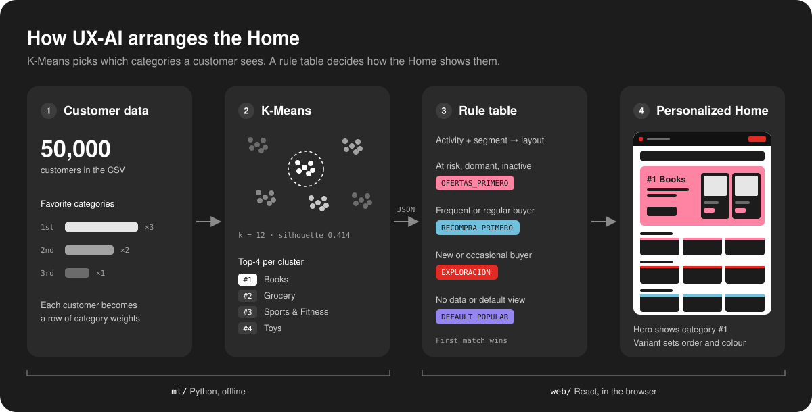

# UX-AI

Prototype of an online store whose home page adapts to each customer.



## What it does

When you pick a customer profile, the store rearranges itself for that customer:

1. **Which categories?** A K-Means model groups 50,000 customers by the categories they prefer. Each group gets its own top-4 categories. The #1 category always goes in the large Hero banner.
2. **How are they arranged?** A simple rule table looks at the customer's activity and buying segment and picks one of four layouts. The layout decides what the Hero highlights, the order of the sections below it and the colour of the page. For example, a customer who has not bought in a while sees offers first.
3. **Transparency.** Every personalized view says that it was arranged automatically and offers a button to restore the default view.

To try it, open the store and switch the profile in the header. Carlos, Ana, Luis and Sofía each land on a different layout.

K-Means is the only machine learning in the project. The layout is plain rules. Products are mock data. The site works on desktop and mobile.

The full design, the components and the decisions are in **[docs/architecture.md](docs/architecture.md)**, the single source of truth.

## Repository structure

| Path | Contents |
|---|---|
| `docs/` | Architecture, layout rules, acceptance criteria, dataset findings |
| `AGENTS.md`, `.claude/skills/` | Instructions for AI coding agents (OpenCode) |
| `contracts/` | JSON schema shared by `ml/` and `web/` |
| `ml/` | Python pipeline: data loading, K-Means, metrics, export |
| `web/` | Vite + React + TypeScript store |

## Getting started

### 1. Install the tools

| Tool | Minimum version | How to install |
|---|---|---|
| Git | 2.30 | https://git-scm.com/downloads |
| uv | 0.5 | https://docs.astral.sh/uv/getting-started/installation/ |
| Python | 3.12 | `uv python install 3.12` (after installing uv) |
| Node.js | 22.12 (any newer LTS works) | https://nodejs.org/en/download |
| pnpm | 10 | https://pnpm.io/installation |

Check them in a new terminal:

```sh
git --version
uv --version
uv python find 3.12
node --version
pnpm --version
```

### 2. Install the project dependencies

Run these from the repository root:

```sh
uv sync --project ml
pnpm --dir web install --frozen-lockfile
pnpm --dir web exec playwright install chromium
```

The last command downloads the browser for the end-to-end tests; skip it if you only run the store.

### 3. Get the dataset (only for ML work)

The dataset is not committed. Ask the team for `E-commerce_Customer_Segmentation_2026.csv` and place it in `ml/data/raw/`. The web app does not need it: it reads small JSON files that the pipeline exports to `web/public/data/` and that are committed with the code.

### 4. Run the project

| Task | Command |
|---|---|
| Run the ML tests | `uv run --project ml pytest` |
| Lint the Python code | `uv run --project ml ruff check ml` |
| Export the model's JSON files (needs the dataset) | `uv run --project ml python -m uxai.export` |
| Start the store locally | `pnpm --dir web dev` |
| Run the web unit tests | `pnpm --dir web test` |
| Run the end-to-end and accessibility tests | `pnpm --dir web e2e` |
| Build the static site | `pnpm --dir web build` |
| Lint the web code | `pnpm --dir web lint` |

## Documentation

- [Architecture](docs/architecture.md)
- [Layout rules](docs/layout-rules.md)
- [Acceptance criteria and traceability](docs/acceptance-criteria.md)
- [Dataset findings](docs/dataset-findings.md)
